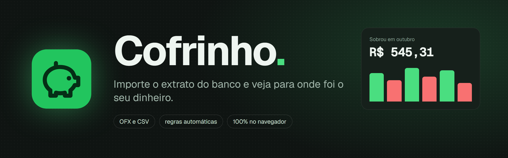
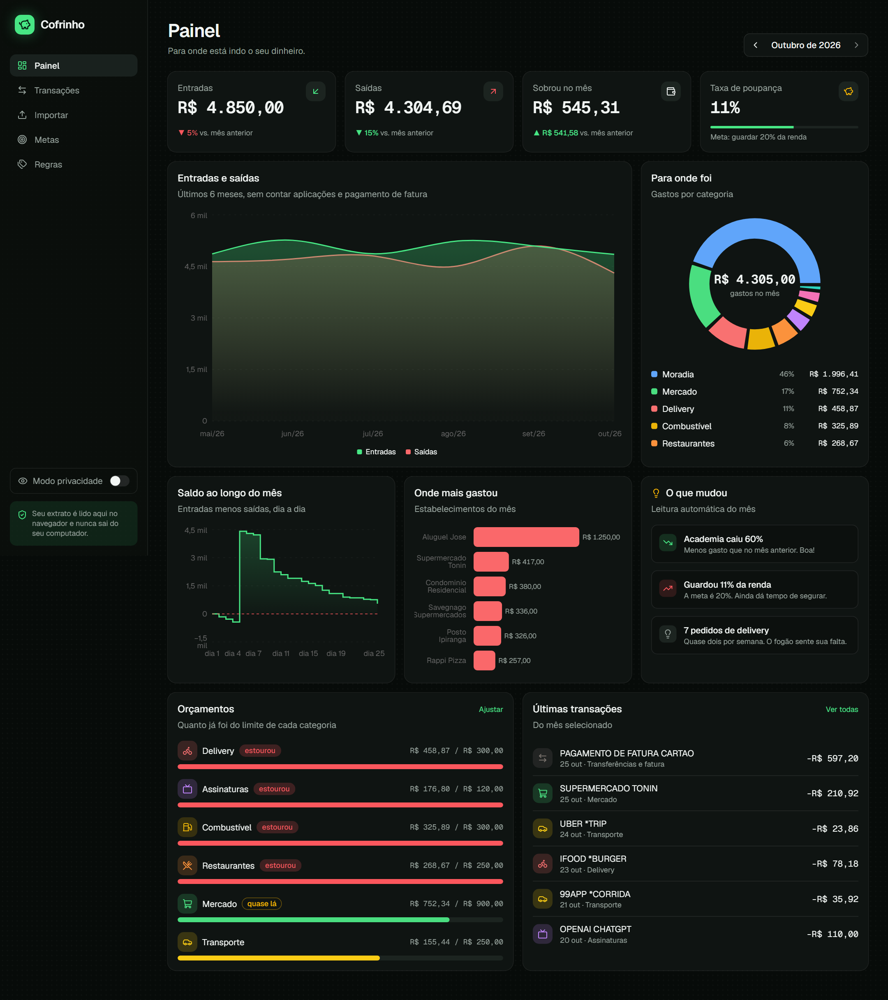
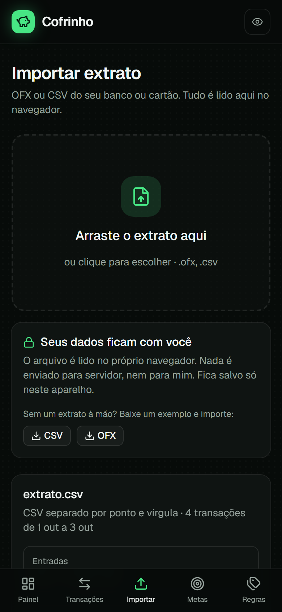
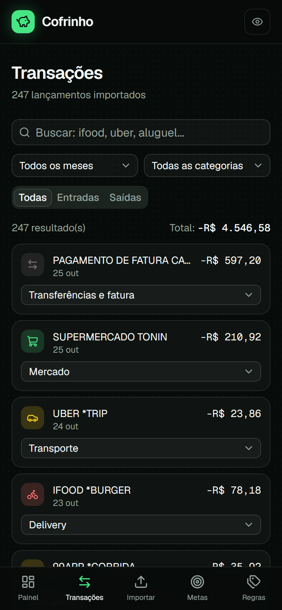
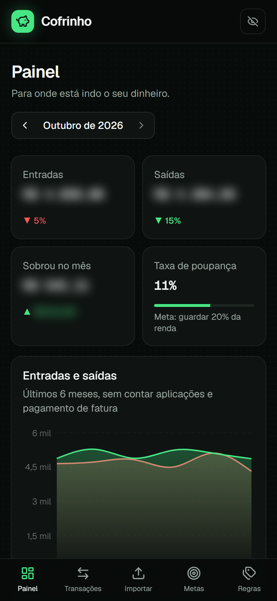

<div align="center">



<br />

[](https://github.com/Bleachless/cofrinho/actions/workflows/ci.yml)


**Controle financeiro pessoal que respeita os seus dados.**
<br />
Você importa o extrato (OFX ou CSV), ele categoriza tudo sozinho e mostra para onde foi o dinheiro.
<br />
O arquivo é lido no navegador e **nunca sai do seu computador**.

</div>

---



## 📱 No celular

<table>
  <tr>
    <td align="center"><br /><sub><b>Painel</b></sub></td>
    <td align="center"><br /><sub><b>Importar</b></sub></td>
    <td align="center"><br /><sub><b>Transações</b></sub></td>
    <td align="center"><br /><sub><b>Modo privacidade</b></sub></td>
  </tr>
</table>

## ✨ O que ele faz

| | |
| --- | --- |
| 📥 **Importa OFX e CSV** | Arraste o extrato do banco ou a fatura do cartão. Mostra uma prévia com período, totais e categorias antes de importar. |
| 🏷️ **Categoriza sozinho** | Regras com palavras que aparecem nos extratos brasileiros: iFood, Savegnago, CPFL, Smart Fit, Uber, Pix... e você cria as suas. |
| 🔁 **Não duplica** | Importou o mesmo extrato duas vezes? As repetidas são reconhecidas pelo `FITID` do OFX ou por data, valor e descrição. |
| 📊 **Painel com gráficos** | Entradas e saídas dos últimos 6 meses, gastos por categoria, saldo dia a dia e onde você mais gastou. |
| 💡 **Leitura do mês** | Frases automáticas: “Delivery subiu 40%”, “Guardou 11% da renda, a meta é 20%”. |
| 🎯 **Metas e orçamentos** | Meta de poupança e limite por categoria, com sugestão automática pela média dos últimos 3 meses. |
| 🙈 **Modo privacidade** | Um clique desfoca todos os valores, para mostrar a tela sem mostrar o saldo. |
| 🔒 **Sem servidor** | Não tem cadastro, não tem banco de dados, não tem API. Os dados ficam no `localStorage` do navegador. |

## 🧠 Como a importação funciona

Extrato de banco brasileiro é bagunçado. O leitor em [`src/lib/parse.ts`](src/lib/parse.ts) lida com isso:

1. **Codificação**: tenta UTF-8 e, se aparecer caractere quebrado, relê como Windows-1252 (o padrão de muitos bancos).
2. **Formato**: OFX em SGML ou XML; CSV com `;`, `,` ou tab, detectando sozinho o separador e a linha de cabeçalho, mesmo com linhas de identificação do banco antes da tabela.
3. **Números e datas**: `R$ -1.234,56`, `1,234.56`, `(45,90)`, `45,90 D`, `05/10/2026`, `5/1/26`, `20261005120000[-3:BRT]`.
4. **Colunas**: valor único ou entrada/saída separadas; fatura de cartão (que lista gasto como positivo) é detectada e os sinais podem ser invertidos.
5. **Categorias**: a primeira regra que bater vence, **respeitando o sinal** (regra de entrada não pega saída). Pagamento de fatura e aplicações viram “transferência” e ficam fora das contas para não contar o mesmo dinheiro duas vezes.

## 🧪 Testes

```bash
npm test
```

São 31 testes com Vitest para os casos chatos de verdade: separador dentro de aspas, cabeçalho no meio do arquivo, OFX com várias tags na mesma linha, “Mercado Livre” que não é supermercado, estorno que não vira gasto... Veja em [`src/lib/parse.test.ts`](src/lib/parse.test.ts). O GitHub Actions roda lint, tipos, testes e build a cada push.

## 🚀 Rodar localmente

```bash
git clone https://github.com/Bleachless/cofrinho.git
cd cofrinho
npm install
npm run dev
```

Abra http://localhost:3000 e clique em **Ver com dados de exemplo**, ou baixe um extrato de exemplo na tela **Importar**.

## 🗂️ Por dentro

```
src/
├── app/                 # Painel, Transações, Importar, Metas, Regras
├── components/
│   ├── charts.tsx       # gráficos com shadcn/ui + Recharts
│   └── ui/              # componentes do shadcn/ui (Base UI)
└── lib/
    ├── parse.ts         # leitor de OFX e CSV
    ├── categories.ts    # categorias e regras padrão
    ├── analytics.ts     # resumos, séries, orçamentos e insights
    ├── store.ts         # estado com zustand, salvo no navegador
    └── parse.test.ts    # testes
```

## 🛣️ Próximos passos

- [ ] Vários cartões e contas separados
- [ ] Gastos parcelados e recorrentes detectados sozinhos
- [ ] Exportar relatório do mês em PDF
- [ ] Criptografar os dados salvos com uma senha local

---

<div align="center">

Feito por **[João Vaz](https://github.com/Bleachless)**, desenvolvedor full stack que trabalha no setor financeiro.
<br />
Veja também o **[Frango Fit](https://github.com/Bleachless/frango-fit)** 🐔

</div>
